# この記事について

この記事は、`microservices-app` / `microservices-infra` を開発するチームメンバー向けの**内部アーキテクチャガイド**です。

目的は「マイクロサービス一般論を網羅すること」ではなく、**このリポジトリでなぜこの構成を採っているのか**、**新しいサービスをどう追加するのか**、**困ったときにどこを見ればよいのか**を把握できるようにすることです。

前提として、このプロジェクトでは `new-service` コマンドで新しいサービスの雛形を生成し、その上に機能を足していく開発フローを想定しています。普段の開発では scaffold の流れを覚えておけば十分ですが、Event Sourcing や Outbox などの用語を知らないと「なぜこう実装されているのか」が見えづらくなります。この記事はそこを埋めるためのものです。

:::message
この記事で説明するのは**この repo における標準形**です。既存サービスの中には、先に実装が進んでいて scaffold より複雑になっているものや、歴史的経緯で配置が少し異なるものがあります。
:::

## 最初に覚えること

この repo を触るときは、まず次の 4 点だけ押さえてください。

1. 新しい Go サービスは `new-service go <name> [port]` で雛形を作る
2. 普段主に触るのは `proto` / `events.go` / `aggregate.go` / `service.go`
3. 保存は `platform.SaveAggregate` が担い、Event Store と Outbox まで 1 トランザクションで処理する
4. Kafka、projection、補償、監視基盤などは「普段は意識しなくてよいが、挙動を理解するために知っておくとよい」層

## この記事の読み方

- **まず読む**: app側の「標準開発フロー」「開発者が編集する4ファイル」「データの流れ」
- **次に読む**: app側の「既存サービスを読むときの手引き」「なぜこの構成なのか」
- **必要になったら読む**: app側の詳細な用語解説と infra側

infra側はローカル Kubernetes 基盤や観測基盤の説明なので、アプリケーション開発だけなら最初は斜め読みで構いません。

# マイクロサービスとは

マイクロサービスとは、アプリケーションを**小さな独立したサービスの集合**として構築するアーキテクチャスタイルです。各サービスは独自のデータベースを持ち、独立してデプロイ・スケールできます。

対義語として「モノリス」があります。モノリスは1つの大きなアプリケーションとして全機能を詰め込む構成です。小規模なうちはシンプルですが、規模が大きくなるとデプロイの影響範囲が広がり、チーム間の調整コストが増大し、特定の機能だけをスケールすることが困難になります。

**1. モノリス**

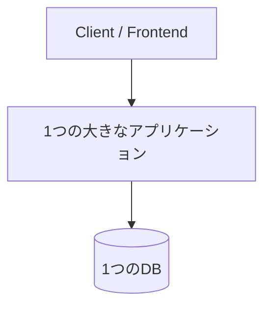

**2. マイクロサービス**

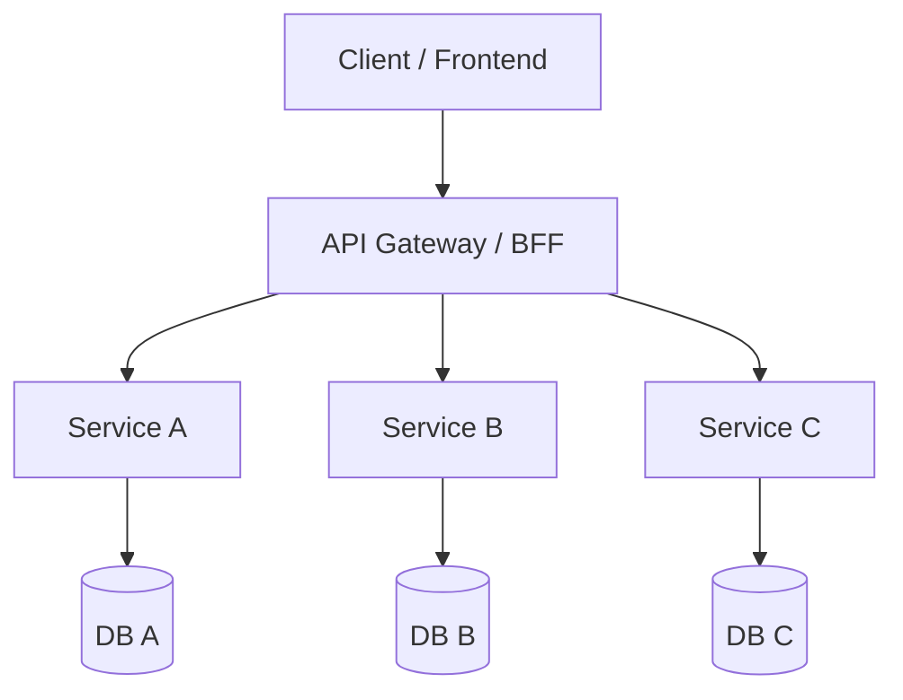

マイクロサービスはこれらの問題に**対処しやすくなる場面がある**一方で、代わりに**分散システム特有の複雑さ**が発生します。サービス間通信、分散トランザクション、データの結果整合性、オブザーバビリティなど、モノリスでは考える必要のなかった課題に直面します。

この記事では、[microservices-app](https://github.com/hackz-megalo-cup/microservices-app) と [microservices-infra](https://github.com/hackz-megalo-cup/microservices-infra) を題材に、**この repo の開発で実際に登場する技術・パターン**を、`new-service` ベースの開発フローに沿って説明します。

なお、マイクロサービスのアーキテクチャパターンについては、成瀬允宣さん（[nrslib.com](https://nrslib.com/)）の登壇資料やDDD入門書が非常にわかりやすいです。成瀬さんは『ドメイン駆動設計入門 ボトムアップでわかる！ドメイン駆動設計の基本』の著者で、ソフトウェアアーキテクチャ、DDD、CQRS、イベント駆動設計などの分野で活躍されています。本記事でも成瀬さんの考え方を参考にしている箇所があります。

# 全体のアーキテクチャ

このプロジェクトは以下のようなサービス構成になっています。図は**主要なリクエスト経路と主要コンポーネントを抜粋したもの**です。

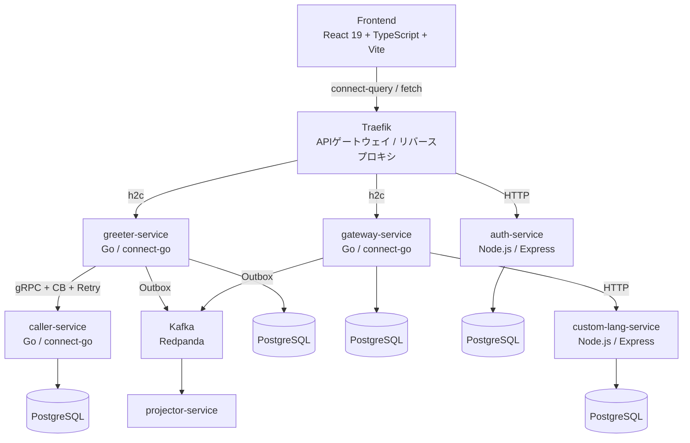

各サービスは基本的に**独自のデータベース**を持ち（Database per Service パターン）、サービス間通信には主に **connect-go ベースの RPC** と **Kafka（Redpanda）** を使います。Node.js サービスとの連携では HTTP も登場します。

# app側

microservices-app側の技術用語を解説します。まずは **この repo で新しいサービスを作るときの標準形** と **データの流れ** を押さえ、その後で各用語を深掘りします。

## 標準開発フロー

チーム開発で最初に頭に入れておきたいのは、`new-service` が前提にしている**標準フロー**です。用語解説は後半にありますが、先にこの流れを掴むと既存コードも読みやすくなります。

```text
new-service
  ↓
proto を決める
  ↓
events / aggregate / service を実装する
  ↓
リクエスト着信
  ↓
Auth / Idempotency Interceptor（service.go に入る前にチェック）
  ↓
service.go → aggregate → SaveAggregate を呼ぶ
  ↓
event_store + outbox_events に保存される
  ↓
Outbox ポーラーが Kafka に流す
  ↓
compensation / observability などの後続処理が動く
```

普段の開発では、上のうち自分が直接書くのは `proto` / `events.go` / `aggregate.go` / `service.go` が中心です。Auth / Idempotency は `main.go` で Connect Interceptor として配線されており、`service.go` のハンドラに入る**前**に処理されます。`SaveAggregate` より下は共通基盤や周辺サービスが担います。

:::message
`new-service` が標準で用意するのは、**Auth Interceptor / Idempotency Interceptor（リクエスト受信時）** と **Event Store / Outbox / 補償ハンドラ（書き込み・後続処理）** までです。read model 用の projection は、既存サービスでは入っていることがありますが、scaffold が毎回自動生成するわけではありません。
:::

## repoの全体像

### 技術スタック

| カテゴリ | 技術 |
|---------|------|
| Go サービス | connect-go / gRPC（greeter, caller, gateway）+ Kafka subscriber / HTTP（projector） |
| Node.js サービス | Express（auth-service, custom-lang-service） |
| フロントエンド | React 19 + TypeScript + Vite + connect-query + TanStack Query |
| データベース | PostgreSQL 17（サービスごとに専用DB） |
| メッセージキュー | Redpanda（Kafka互換）+ Watermill（Go） / KafkaJS（Node.js） |
| スキーマ管理 | Protocol Buffers（buf） |
| リバースプロキシ | Traefik v3 |
| 開発環境 | Nix / devenv / Docker Compose / Tilt |

### サービス構成

| サービス | 言語/FW | 役割 | DB |
|---------|---------|------|----|
| greeter-service | Go / connect-go | Event Sourcing + CQRS + Saga の中核 | greeter_db |
| caller-service | Go / connect-go | 外部API呼び出し + Outboxパターン | caller_db |
| gateway-service | Go / connect-go | custom-lang-serviceのオーケストレーション + Saga + Circuit Breaker | gateway_db |
| projector-service | Go | Kafkaからイベントを購読し、`greetings_view` / `invocations_view` などの view を更新。再構築時は `greeter_db` の event store も参照する | `gateway_db`（view / event_log 用） |
| auth-service | Node.js / Express | JWT認証（RS256） + JWKS + `/verify` エンドポイント | auth_db |
| custom-lang-service | Node.js / Express | gatewayからの呼び出しを受けて実行を記録 | lang_db |
| frontend | React 19 + TypeScript | 主に connect-query で型安全に RPC 呼び出し。auth 系は HTTP エンドポイントも使う | - |

各サービスが専用のデータベースを持つ **Database per Service パターン** を基本にしています。read model は例外的に projection 用のテーブルへ書き込まれますが、これは「他サービスの業務テーブルを直接更新する」のとは別物です。

### データの流れ

リクエストがどう処理されるかの全体像です。これがこのアプリケーションの中核となるフローです。

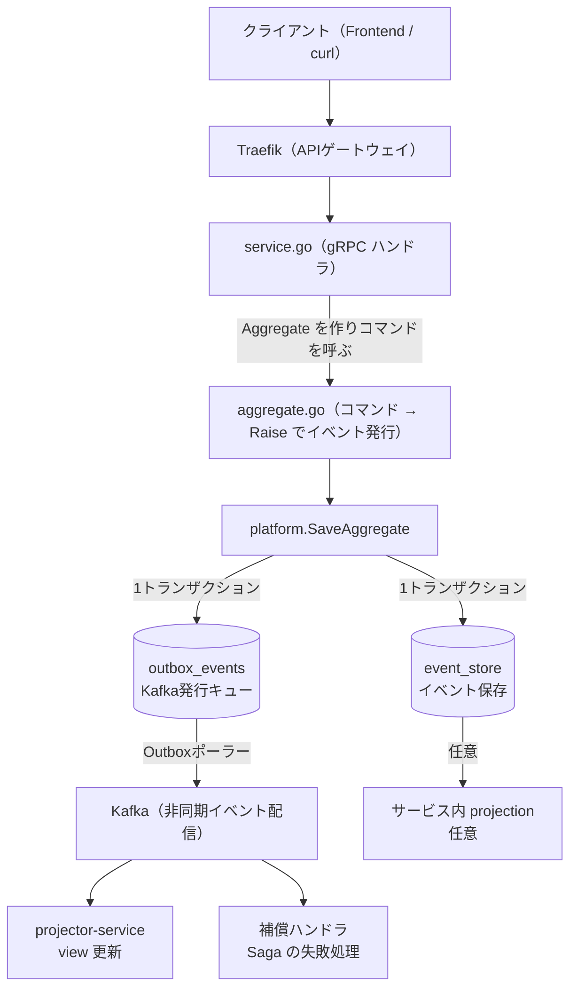

このフローのうち、`new-service` で生成される Go サービスの基本形は **`SaveAggregate` まで + Outbox / 補償ハンドラ** です。`LocalProj` や `projector-service` は既存サービスでよく出てくる拡張なので、後述する **Event Sourcing**、**CQRS**、**Outbox パターン**、**Saga パターン** は「どのサービスがどこまで採用しているか」を意識しながら読むと理解しやすくなります。

### 共通基盤（platform パッケージ）

Go サービスの共通パターンは `/services/internal/platform/` に集約されています。新しいサービスを作るとき、開発者は普段これらの実装を直接編集しません。`new-service` が雛形を生成し、通常はその上にビジネスロジックを足していく形になります。

| パッケージ | 役割 |
|-----------|------|
| `eventstore.go` | イベントの保存と読み出し（楽観的ロック付き） |
| `aggregate.go` | 集約のベースクラス + SaveAggregate / LoadAggregate |
| `outbox.go` | Outboxパターン（DBとKafka発行のアトミック化） |
| `compensation.go` | Saga補償ルーター |
| `circuitbreaker.go` | Circuit Breakerラッパー |
| `bulkhead.go` | 同時実行数の制限 |
| `retry.go` | 指数バックオフ付きリトライ |
| `idempotency.go` | 冪等性Interceptor |
| `snapshot.go` | Event Sourcingのスナップショット |
| `upcaster.go` | イベントスキーマのバージョンアップ |

## scaffold での実装手順

アーキテクチャを理解したところで、実際にどう開発していくかを見ていきます。ここが**この repo で一番重要な主線**です。用語の詳細は後述の「用語解説」で解説するので、まずは「新しいサービスをどう足すか」を掴んでください。

### 環境構築

開発環境は **Nix / devenv** で管理されています。通常は repo で `direnv allow` を実行すれば、Go, Node.js, buf, kubectl, tilt 等の必要なツールが揃います。`direnv` を使わない場合は `devenv shell` でシェルに入ってから作業します。

:::message
本文中の `new-service` は `microservices-app` 側、`bootstrap` / `bootstrap-full` / `full-bootstrap` は `microservices-infra` 側で `direnv allow` 後に使える **devenv コマンド** です。コマンドが見つからない場合は、まず対象の repo 側で `direnv allow` が済んでいるかを確認してください。
:::

```bash
# 1. リポジトリをclone
git clone https://github.com/hackz-megalo-cup/microservices-app
cd microservices-app
direnv allow   # 開発ツールが自動インストールされる

# 2. 環境変数の設定
cp .env.example .env
cp frontend/.env.example frontend/.env
```

### 起動方法

4つの起動方法があります。

| 方法 | コマンド | 特徴 |
|------|---------|------|
| **Kind + Tilt（dev-fast）** | `bootstrap` → `tilt up` | 日常開発向け。kindnetd ベースで最も軽く、2回目以降は warm cluster が効く |
| **Kind + Tilt（Cilium）** | `bootstrap-full` または `bootstrap --full` → `tilt up` | Cilium + Hubble を使ってネットワーク可視化も確認したいとき向け |
| **Kind + Tilt（full）** | `full-bootstrap` → `tilt up` | Cilium + Istio Ambient + ArgoCD を含むフルスタック検証向け |
| **Docker Compose** | `docker compose up` | 監視基盤なし。スペック的に k8s が厳しい場合に |

```bash
# Docker Compose で手軽に起動する場合
docker compose up

# Kind + Tilt で起動する場合（別途 microservices-infra が必要）
# ※ 2つの repo が兄弟ディレクトリにある前提です
cd ../microservices-infra
direnv allow          # または devenv shell
bootstrap             # dev-fast
# bootstrap-full      # Cilium モード
# full-bootstrap      # フルスタック
cd ../microservices-app && tilt up
```

| URL | サービス |
|-----|----------|
| http://localhost:30081 | Traefik（APIゲートウェイ） |
| http://localhost:10350 | Tiltダッシュボード（Tilt使用時） |
| http://localhost:30300 | Grafana（admin/admin）（`bootstrap-full` / `full-bootstrap` 時） |
| http://localhost:30090 | Prometheus（`bootstrap-full` / `full-bootstrap` 時） |
| http://localhost:30082 | Redpanda Console（`bootstrap-full` / `full-bootstrap` 時） |
| http://localhost:31235 | Hubble UI（`bootstrap-full` / `full-bootstrap` 時） |

:::message
現行 main ブランチの `Tiltfile` / `tilt-services.json` / `deploy/k8s/` で自動起動されるのは、主に `greeter` / `caller` / `gateway` / `auth-service` / `custom-lang-service` / `frontend` です。`projector-service` は repo には存在しますが、現状は Docker Compose には配線されている一方で、Tilt / k8s には未配線です。
:::

### 新しいサービスの追加

新しいマイクロサービスは `new-service` コマンド一発で雛形が生成されます。この記事でいう「標準形」は基本的にこの scaffold を指しています。

```bash
new-service go <service-name> [port]
# 例: new-service go todo 9000
# port を省略するとデフォルト 8080 が使われる
```

ソースコード、proto定義、Dockerfile、Docker Compose 向けのエントリ、DB、Kafkaトピック、`deploy/k8s/<service>.nix`、`deploy/nixidy/env/local.nix`、`deploy/k8s/secrets.nix`、`tilt-services.json` まで自動で配線されます。

:::message
現行の scaffold では **`Tiltfile` の手修正は不要** です。`Tiltfile` は `tilt-services.json` を読んで動的にサービスを登録するため、`new-service` 実行後は `tilt up` が新サービスを自動検出します。

また、`new-service` は flake から見えるように必要な Nix ファイルを `git add` するところまで面倒を見ます。あとから `deploy/k8s/*.nix` を手で追加した場合だけ、別途 `git add` を忘れないようにしてください。
:::

### 開発者が編集する4ファイル

サービスの雛形が生成されたら、開発者が主に触るのは基本的に **4ファイル** です。

:::message
これは **scaffold から新しく作るサービスの標準形** の話です。既存サービスの中には、先に実装が進んでいて `events.go` が別ファイルになっていなかったり、追加の projection / 補助コードを持っていたりするものがあります。
:::

#### 1. `proto/<service>/v1/<service>.proto` — API定義

gRPC の API 定義。編集後 `buf generate` でサーバー/クライアントのコードを再生成します。scaffold 直後の `Invoke` ベースの雛形を、たとえば次のように**丸ごと差し替える**イメージです。

```diff proto:proto/todo/v1/todo.proto
 syntax = "proto3";
 
 package todo.v1;
 
 option go_package = "github.com/hackz-megalo-cup/microservices-app/services/gen/go/todo/v1;todov1";
 
 service TodoService {
-  rpc Invoke(TodoRequest) returns (TodoResponse) {}
+  rpc CreateTodo(CreateTodoRequest) returns (CreateTodoResponse) {}
+  rpc UpdateTodoTitle(UpdateTodoTitleRequest) returns (UpdateTodoTitleResponse) {}
+  rpc DeleteTodo(DeleteTodoRequest) returns (DeleteTodoResponse) {}
 }
 
-message TodoRequest {
-  string input = 1;
+message CreateTodoRequest {
+  string title = 1;
 }
 
-message TodoResponse {
-  string output = 1;
+message CreateTodoResponse {
+  string id = 1;
+}
+
+message UpdateTodoTitleRequest {
+  string id = 1;
+  string title = 2;
+}
+
+message UpdateTodoTitleResponse {}
+
+message DeleteTodoRequest {
+  string id = 1;
+}
+
+message DeleteTodoResponse {}
```

#### 2. `services/internal/<service>/events.go` — イベント定義

イベント型とペイロードを定義します。イベントは「起きた事実」を表します。

:::message alert
テンプレートが生成する `Failed` / `Compensated` イベントは `main.go` の補償ハンドラが参照しています。**削除すると `main.go` がコンパイルエラーになる**ので、必ず残してください。
:::

```diff go:services/internal/todo/events.go
 package todo
 
 const (
     EventTodoCreated = "todo.created"
-    // ↓ ドメインイベントを追加する
-    // 例: EventTodoCompleted = "todo.completed"
+    EventTodoTitleUpdated = "todo.title_updated"
+    EventTodoDeleted = "todo.deleted"
 
     EventTodoFailed      = "todo.failed"      // main.go が参照 — 削除禁止
     EventTodoCompensated = "todo.compensated" // main.go が参照 — 削除禁止
 )
 
 // TodoCreatedData — 作成イベントのペイロード。
 // ドメインに合わせてフィールドを書き換える。
 type TodoCreatedData struct {
-    // 例: Title string `json:"title"`
+    Title string `json:"title"`
 }
 
-// ↓ 追加イベントのペイロードをここに定義する
-// 例: type TodoCompletedData struct{}
+type TodoTitleUpdatedData struct {
+    Title string `json:"title"`
+}
+
+type TodoDeletedData struct{}
 
 // --- 以下は main.go の補償ハンドラが使用。型名とフィールドは残すこと。 ---
 
 type TodoFailedData struct {
     Input string `json:"input"`
     Error string `json:"error"`
 }
 
 type TodoCompensatedData struct {
     Reason string `json:"reason"`
 }
```

#### 3. `services/internal/<service>/aggregate.go` — 集約

集約の状態と、イベント適用ロジック。`ApplyEvent` でイベントから状態を復元し、コマンドメソッドで `Raise()` を呼んでイベントを発行します。

```diff go:services/internal/todo/aggregate.go
 package todo
 
 import (
     "encoding/json"
     "log/slog"
 
     "github.com/hackz-megalo-cup/microservices-app/services/internal/platform"
 )
 
 // ==========================================================.
 // Aggregate — ドメインエンティティ。
 // ↓ ドメインの状態フィールドを追加する（例: Title string）
 // ==========================================================.
 
 type TodoAggregate struct {
     platform.AggregateBase
+    Title   string
     Status string
 }
 
 func NewTodoAggregate(id string) *TodoAggregate {
     return &TodoAggregate{
         AggregateBase: platform.NewAggregateBase(id),
     }
 }
 
 func (a *TodoAggregate) StreamType() string { return "todo" }
 
 // ApplyEvent はイベントを再生して状態を復元する。
 // Created の case を書き換え、追加イベントの case を足す。
 func (a *TodoAggregate) ApplyEvent(eventType string, data json.RawMessage) {
     switch eventType {
     case EventTodoCreated:
         var d TodoCreatedData
         if err := json.Unmarshal(data, &d); err != nil {
             slog.Warn("failed to unmarshal created data", "error", err)
         }
-        // ↓ フィールドの復元を書く（例: a.Title = d.Title）
+        a.Title = d.Title
         a.Status = "created"
-    // ↓ 追加イベントの case をここに足す
-    // 例:
-    // case EventTodoCompleted:
-    //     a.Status = "completed"
+    case EventTodoTitleUpdated:
+        var d TodoTitleUpdatedData
+        if err := json.Unmarshal(data, &d); err != nil {
+            slog.Warn("failed to unmarshal title updated data", "error", err)
+        }
+        a.Title = d.Title
+        a.Status = "updated"
+    case EventTodoDeleted:
+        a.Status = "deleted"
     case EventTodoFailed:
         a.Status = "failed"
     case EventTodoCompensated:
         a.Status = "compensated"
     }
 }
 
 // ==========================================================.
 // コマンドメソッド — Raise() でイベントを発行し、状態を更新する。
 //
 // Fail / Compensate は main.go の補償ハンドラが参照 — 削除禁止。
 // AggregateID() で集約の ID を取得できる。
 // 既存集約のロード: platform.LoadAggregate(ctx, eventStore, agg)
 // ==========================================================.
 
 // Create — 引数をドメインに合わせて変更する（例: Create(title string)）
-func (a *TodoAggregate) Create() {
+func (a *TodoAggregate) Create(title string) {
     a.Raise(EventTodoCreated, TodoCreatedData{
-        // ↓ フィールドを渡す（例: Title: title）
+        Title: title,
     })
-    // ↓ 状態を更新する（例: a.Title = title）
+    a.Title = title
     a.Status = "created"
 }
 
-// ↓ 追加コマンドをここに定義する
-// 例:
-// func (a *TodoAggregate) Complete() {
-//     a.Raise(EventTodoCompleted, TodoCompletedData{})
-//     a.Status = "completed"
-// }
+func (a *TodoAggregate) UpdateTitle(title string) {
+    a.Raise(EventTodoTitleUpdated, TodoTitleUpdatedData{
+        Title: title,
+    })
+    a.Title = title
+    a.Status = "updated"
+}
+
+func (a *TodoAggregate) Delete() {
+    a.Raise(EventTodoDeleted, TodoDeletedData{})
+    a.Status = "deleted"
+}
 
 // Fail records a failed operation — main.go が参照、削除禁止。
 func (a *TodoAggregate) Fail(input string, reason string) {
     a.Raise(EventTodoFailed, TodoFailedData{
         Input: input,
         Error: reason,
     })
     a.Status = "failed"
 }
 
 // Compensate marks this aggregate as compensated — main.go が参照、削除禁止。
 func (a *TodoAggregate) Compensate(reason string) {
     if a.Status == "compensated" {
         return
     }
     a.Raise(EventTodoCompensated, TodoCompensatedData{
         Reason: reason,
     })
     a.Status = "compensated"
 }
 
 // TodoTopicMapper maps event types to Kafka topics.
 func TodoTopicMapper(eventType string) string {
     switch eventType {
     case EventTodoCreated:
         return platform.TopicTodoCreated
+    case EventTodoTitleUpdated:
+        return platform.TopicTodoTitleUpdated
+    case EventTodoDeleted:
+        return platform.TopicTodoDeleted
     case EventTodoFailed:
         return platform.TopicTodoFailed
+    case EventTodoCompensated:
+        return platform.TopicTodoCompensated
     default:
         return ""
     }
 }
```

`Raise()` したあとにコマンドメソッド側でも状態を更新しているのは、**そのリクエスト中ですぐに最新状態を使えるようにするため**です。`ApplyEvent` は保存済みイベントを再生するときの復元ロジック、コマンドメソッド側の代入は「今この場で変わった状態」を即座に反映するための処理、と考えると整理しやすいです。

#### 4. `services/internal/<service>/service.go` — ビジネスロジック

gRPCハンドラの実装。集約を作り、コマンドを呼び、`SaveAggregate` で永続化するのが基本です。

```diff go:services/internal/todo/service.go
 package todo
 
 import (
     "context"
     "fmt"
     "log/slog"
 
     "connectrpc.com/connect"
     "github.com/google/uuid"
 
     pb "github.com/hackz-megalo-cup/microservices-app/services/gen/go/todo/v1"
     "github.com/hackz-megalo-cup/microservices-app/services/internal/platform"
 )
 
 type Service struct {
     eventStore *platform.EventStore
     outbox     *platform.OutboxStore
 }
 
 func NewService(eventStore *platform.EventStore, outbox *platform.OutboxStore) *Service {
     return &Service{
         eventStore: eventStore,
         outbox:     outbox,
     }
 }
 
 // ==========================================================.
 // proto を編集して RPC を定義したら、このメソッドを書き換える。
 //
 // 新規作成パターン:
 //   agg := NewTodoAggregate(uuid.NewString())
 //   agg.Create(...)
 //   platform.SaveAggregate(ctx, s.eventStore, s.outbox, agg, TodoTopicMapper)
 //   return agg.AggregateID()  // 生成された ID
 //
 // 既存更新パターン:
 //   agg := NewTodoAggregate(id)
 //   platform.LoadAggregate(ctx, s.eventStore, agg)  // イベント再生で状態復元
 //   agg.SomeCommand()
 //   platform.SaveAggregate(ctx, s.eventStore, s.outbox, agg, TodoTopicMapper)
 // ==========================================================.
 
-func (s *Service) Invoke(ctx context.Context, req *connect.Request[pb.TodoRequest]) (*connect.Response[pb.TodoResponse], error) {
-    input := req.Msg.GetInput()
-    if input == "" {
-        return nil, connect.NewError(connect.CodeInvalidArgument, fmt.Errorf("input is required"))
-    }
-
-    agg := NewTodoAggregate(uuid.NewString())
-    agg.Create()
-    if err := platform.SaveAggregate(ctx, s.eventStore, s.outbox, agg, TodoTopicMapper); err != nil {
-        slog.Error("failed to save aggregate", "error", err)
-        return nil, connect.NewError(connect.CodeInternal, fmt.Errorf("failed to save"))
-    }
-
-    return connect.NewResponse(&pb.TodoResponse{
-        Output: agg.AggregateID(),
-    }), nil
-}
+func (s *Service) CreateTodo(ctx context.Context, req *connect.Request[pb.CreateTodoRequest]) (*connect.Response[pb.CreateTodoResponse], error) {
+    title := req.Msg.GetTitle()
+    if title == "" {
+        return nil, connect.NewError(connect.CodeInvalidArgument, fmt.Errorf("title is required"))
+    }
+
+    agg := NewTodoAggregate(uuid.NewString())
+    agg.Create(title)
+    if err := platform.SaveAggregate(ctx, s.eventStore, s.outbox, agg, TodoTopicMapper); err != nil {
+        slog.Error("failed to save aggregate", "error", err)
+        return nil, connect.NewError(connect.CodeInternal, fmt.Errorf("failed to save"))
+    }
+
+    return connect.NewResponse(&pb.CreateTodoResponse{
+        Id: agg.AggregateID(),
+    }), nil
+}
+
+func (s *Service) UpdateTodoTitle(ctx context.Context, req *connect.Request[pb.UpdateTodoTitleRequest]) (*connect.Response[pb.UpdateTodoTitleResponse], error) {
+    id := req.Msg.GetId()
+    if id == "" {
+        return nil, connect.NewError(connect.CodeInvalidArgument, fmt.Errorf("id is required"))
+    }
+    title := req.Msg.GetTitle()
+    if title == "" {
+        return nil, connect.NewError(connect.CodeInvalidArgument, fmt.Errorf("title is required"))
+    }
+
+    agg := NewTodoAggregate(id)
+    if err := platform.LoadAggregate(ctx, s.eventStore, agg); err != nil {
+        slog.Error("failed to load aggregate", "error", err)
+        return nil, connect.NewError(connect.CodeInternal, fmt.Errorf("failed to load aggregate"))
+    }
+    agg.UpdateTitle(title)
+    if err := platform.SaveAggregate(ctx, s.eventStore, s.outbox, agg, TodoTopicMapper); err != nil {
+        slog.Error("failed to save aggregate", "error", err)
+        return nil, connect.NewError(connect.CodeInternal, fmt.Errorf("failed to save"))
+    }
+
+    return connect.NewResponse(&pb.UpdateTodoTitleResponse{}), nil
+}
+
+func (s *Service) DeleteTodo(ctx context.Context, req *connect.Request[pb.DeleteTodoRequest]) (*connect.Response[pb.DeleteTodoResponse], error) {
+    id := req.Msg.GetId()
+    if id == "" {
+        return nil, connect.NewError(connect.CodeInvalidArgument, fmt.Errorf("id is required"))
+    }
+
+    agg := NewTodoAggregate(id)
+    if err := platform.LoadAggregate(ctx, s.eventStore, agg); err != nil {
+        slog.Error("failed to load aggregate", "error", err)
+        return nil, connect.NewError(connect.CodeInternal, fmt.Errorf("failed to load aggregate"))
+    }
+    agg.Delete()
+    if err := platform.SaveAggregate(ctx, s.eventStore, s.outbox, agg, TodoTopicMapper); err != nil {
+        slog.Error("failed to save aggregate", "error", err)
+        return nil, connect.NewError(connect.CodeInternal, fmt.Errorf("failed to save"))
+    }
+
+    return connect.NewResponse(&pb.DeleteTodoResponse{}), nil
+}
```

:::message
ここでは write 側をわかりやすくするために `Create / Update / Delete` を例にしています。`Read` はこの repo では event store を直接読むより、projection や view を経由することが多いです。
:::

### 4ファイル以外で追加しがちな1箇所

普段は 4 ファイルが主戦場ですが、**独自イベントを増やす**ときは次の 1 箇所も触ります。

#### 5. `services/internal/platform/topics.go` — 追加イベントのトピック定義

`new-service` は scaffold 時点の `Created / Failed / Compensated` までは `topics.go` に自動追加しますが、今回の `todo.title_updated` や `todo.deleted` のような**あとから足したイベント**は自分で追記する必要があります。

```diff go:services/internal/platform/topics.go
 const (
     TopicTodoCreated      = "todo.created"
+    TopicTodoTitleUpdated = "todo.title_updated"
+    TopicTodoDeleted      = "todo.deleted"
     TopicTodoFailed       = "todo.failed"
     TopicTodoCompensated  = "todo.compensated"
 )
 
 func DefaultTopics() map[string]int32 {
     return map[string]int32{
         TopicTodoCreated:      3,
+        TopicTodoTitleUpdated: 1,
+        TopicTodoDeleted:      1,
         TopicTodoFailed:       1,
         TopicTodoCompensated:  1,
     }
 }
```

これを忘れると、`aggregate.go` の `TodoTopicMapper` が参照している `platform.TopicTodoTitleUpdated` / `platform.TopicTodoDeleted` などが未定義になり、コンパイルが通りません。

### 触らないファイル

:::message
以下は scaffold が自動生成するボイラープレートです。普段は編集不要ですが、トラブルシュート時には「どこで何が起きているか」を知るために読むことがあります。
:::

- `services/cmd/<service>/main.go` — サーバー起動、DB接続、gRPC登録、補償ハンドラ
- `services/internal/platform/` — EventStore, Outbox, CircuitBreaker 等の共通基盤
- `services/internal/<service>/migrations/` — DDLマイグレーション

### マイグレーションを追加するとき

`migrations/` は「一切触らない場所」ではありません。**新しいテーブルやカラムを足すときは、ここに up/down を追加する**のが標準です。

1. `services/internal/<service>/migrations/` に、既存の連番に続く `NNN_xxx.up.sql` / `NNN_xxx.down.sql` を追加する
2. サービス起動時に `main.go` が embed された migration を自動実行するので、`docker compose up` や `tilt up` で反映を確認する
3. 既存ファイルの書き換えより、**新しい migration を足して前進させる**方を優先する

```text
services/internal/todo/migrations/
  001_create_todos.up.sql
  001_create_todos.down.sql
  002_add_status_index.up.sql
  002_add_status_index.down.sql
```

### 動作確認

:::details curl（API テスト）
```bash
# トークン取得
TOKEN=$(curl -s -X POST http://localhost:30081/auth/login \
  -H "Content-Type: application/json" \
  -d '{"email":"test@example.com","password":"pass123"}' | jq -r '.token')

# CreateTodo
TODO_ID=$(curl -s -X POST http://localhost:30081/todo.v1.TodoService/CreateTodo \
  -H "Content-Type: application/json" \
  -H "Authorization: Bearer $TOKEN" \
  -d '{"title": "buy milk"}' | jq -r '.id')

# UpdateTodoTitle
curl -s -X POST http://localhost:30081/todo.v1.TodoService/UpdateTodoTitle \
  -H "Content-Type: application/json" \
  -H "Authorization: Bearer $TOKEN" \
  -d "{\"id\":\"${TODO_ID}\",\"title\":\"buy oat milk\"}"

# DeleteTodo
curl -s -X POST http://localhost:30081/todo.v1.TodoService/DeleteTodo \
  -H "Content-Type: application/json" \
  -H "Authorization: Bearer $TOKEN" \
  -d "{\"id\":\"${TODO_ID}\"}"

# DB確認（k8s）

# event_store
kubectl exec -n database postgresql-0 -c postgresql -- \
  env PGPASSWORD=devpass psql -U devuser -d todo_db \
  -c 'SELECT stream_id, event_type, version, data FROM event_store ORDER BY created_at;'

# outbox_events
kubectl exec -n database postgresql-0 -c postgresql -- \
  env PGPASSWORD=devpass psql -U devuser -d todo_db \
  -c 'SELECT id, topic, published, created_at FROM outbox_events ORDER BY created_at;'
```
:::

### トラブルシュート

困ったときは、まず「どの層で止まっているか」を切り分けます。

- **Outbox が詰まっていそう**: `outbox_events` の `published = FALSE` が溜まっていないかを確認します。溜まっているなら、Outbox ポーラー、Kafka 接続、topic 名を疑います
- **Circuit Breaker が open していそう**: 呼び出し先サービスの `/healthz`、Traefik 経由の疎通、直前のエラーログを見ます。短時間に失敗が続くと一時的にアプリ側で遮断されます
- **projection が遅い / read model が更新されない**: 元イベントが `event_store` や Kafka まで出ているかを先に確認します。Docker Compose では `projector-service`、`greeter-service` ではサービス内 projection のログを見ます。現行の Tilt / k8s では `projector-service` が未配線なので、その前提で切り分けます
- **新サービスが Tilt に出てこない**: `tilt-services.json` にエントリが追加されているか、`deploy/k8s/<service>.nix` が生成されているか、`new-service` 実行時にエラーが出ていないかを先に確認します。手で Nix ファイルを追加したなら `git add` 漏れも疑います

`published = FALSE` の outbox が増えているのか、`event_store` にそもそも入っていないのかで、見る場所はかなり変わります。最初に DB とログを両方確認する癖をつけると追いやすいです。

---

## 既存サービスを読むときの手引き

ここまでが `new-service` を起点にした標準形です。既存サービスを読むときは、最初から全ファイルを追うのではなく、**標準形からどこが拡張されているか**を見ると迷いにくくなります。

### 読む順番

1. まず `service.go` を読んで、そのサービスが外から何を受け取り、何を返すかを見る
2. 次に `aggregate.go` を読んで、どのイベントを発行し、状態をどう復元するかを見る
3. その後で `main.go` を読んで、DB、Outbox、補償ハンドラ、Interceptor、必要なら projection の配線を確認する
4. 最後に projection や `projector-service`、infra 側の設定を見る

### まず意識するとよい見分け方

- **標準形に近いか**: `proto` / `events.go` / `aggregate.go` / `service.go` が中心なら読みやすい
- **発展形か**: projection、補償、複数バージョン API、他サービス連携が増えると読み筋が増える
- **支援サービスか**: caller や auth のように、他サービスのための補助的な責務を持つものもある

### 既存サービスごとの見どころ

- `greeter-service`
  Event Sourcing と CQRS の例として最も要素が多いです。`service.go` で caller を呼び、`aggregate.go` でイベントを発行し、`main.go` で projection と補償ハンドラを配線しています。
- `gateway-service`
  HTTP で `custom-lang-service` を呼ぶオーケストレーション役です。Circuit Breaker / Bulkhead / Retry がどう組み合わさっているかを見ると、この repo の耐障害設計がわかりやすいです。
- `projector-service`
  scaffold から作る通常の業務サービスというより、Kafka からイベントを購読して `greetings_view` / `invocations_view` を育てる専用サービスです。`service.go` を探すより、`services/internal/projector/handler.go` と `services/internal/projector/projections.go` を先に見る方が全体像を掴みやすいです。
- `caller-service` / `auth-service` / `custom-lang-service`
  主役ではなく周辺サービスです。全体像を知るには重要ですが、最初に全部を深追いする必要はありません。

### `greeter-service` を1周して読む

最初に既存サービスを1つ読むなら、`greeter-service` がおすすめです。この repo の主要な要素が一通り入っています。

1. `services/internal/greeter/service.go`
   まず入口です。`Greet` が caller-service を呼び、成功時は `persistGreeting`、失敗時は `publishFailedEvent` に流れることがわかります。
2. `services/internal/greeter/aggregate.go`
   `GreetingCreated` / `GreetingFailed` / `GreetingCompensated` がどんな状態遷移を表すかを確認します。ここで「イベントが真実」という感覚が掴めます。
3. `services/cmd/greeter/main.go`
   DB 初期化、Outbox ポーラー、`GreetingProjection`、補償ハンドラ、Interceptor の配線を見ます。`main.go` はドメインロジックではなく「仕組みの接着剤」です。
4. `services/internal/greeter/projection.go`
   `event_store` から `greetings` テーブルへ read model を起こす処理を見ます。`greeter-service` の CQRS read 側はここです。

`greeter-service` を追うときに混乱しやすいのは、read 側が 2 層あることです。

- `services/internal/greeter/projection.go`
  `greeter_db` 内の `greetings` テーブルを更新する、サービス内 projection
- `projector-service`
  Kafka を購読して `gateway_db` 側の `greetings_view` / `invocations_view` を更新する別サービス

`greeter-service` を読むときは、次の 2 本の流れだけ追えば十分です。

- **成功系**
  `Greet` → caller 呼び出し成功 → `agg.Create(...)` → `SaveAggregate` → event_store / outbox → `greeter` 内 projection および `projector-service` 側の read model 更新
- **失敗系**
  `Greet` → caller 呼び出し失敗 → `publishFailedEvent` → `greeting.failed` → 補償ハンドラ → `greeting.compensated`

この 2 本が追えれば、`gateway-service` や `projector-service` もだいぶ読みやすくなります。

### 迷いやすいポイント

- 記事では `events.go` を標準形として説明していますが、既存サービスではイベント定義が `aggregate.go` に同居しているものがあります
- read model は「各サービスの業務テーブル」とは別物です。projection 用テーブルや view を更新していると考えると整理しやすいです
- `main.go` は「本質的なドメインロジック」より「配線」が主です。最初から深掘りしすぎない方が追いやすいです

## なぜこの構成なのか

ここから先の用語解説は、単なる用語集ではなく「この repo でなぜそうしているか」を説明するパートです。先に要点だけ並べると、こうなります。

| 困りごと | この repo での解決策 |
|---------|----------------------|
| Go / TS 間で API のズレを減らしたい | gRPC / connect-go + protobuf |
| DB保存と非同期イベント発行のズレを避けたい | Event Store + Outbox + `SaveAggregate` |
| 状態変化の履歴を残したい | Event Sourcing |
| 読み取りを素早くしたい | CQRS + projection |
| 他サービス障害の巻き込みを減らしたい | Circuit Breaker / Bulkhead / Retry |
| 重複送信や再試行に耐えたい | Idempotency |
| 失敗時に後続処理を戻したい | 失敗イベント + 補償ハンドラ |

この表を頭に置いたうえで読むと、各用語が「知識」ではなく「設計上の理由」としてつながります。

## 用語解説

### gRPC / connect-go

#### なぜこれが必要なのか

モノリスでは、関数を直接呼び出せばサービス間のやり取りは完結します。しかしマイクロサービスでは、サービスが別プロセス・別コンテナとして動くため、**ネットワーク越しの通信**が必要になります。

この repo では、Go サービス間通信とフロントエンドからの API 呼び出しに **gRPC / Connect** を採用しています。REST + OpenAPI でも同様のことはできますが、この repo では次の点を重視しました。

- **Proto を単一の契約にしたい**
- **Go / TypeScript 両方にコード生成したい**
- **Connect / gRPC / gRPC-Web を同居させたい**

**gRPC** は Protocol Buffers（protobuf）でスキーマを厳密に定義し、バイナリシリアライゼーションで高速に通信するRPCフレームワークです。HTTP/2ベースでストリーミングもサポートします。

ここで重要なのが **Contract Driven Development（契約駆動開発）** という考え方です。Proto定義ファイル（`.proto`）がサービス間の「契約（Contract）」となり、サーバーもクライアントも**契約からコードを自動生成**します。これにより、実装を始める前にAPI仕様が固まり、チーム間の認識齟齬やインターフェースの不整合を減らせます。

**connect-go** は Buf社が開発した gRPC互換のGoライブラリで、標準の `net/http` 上で動作します。1つのサーバーで **Connect プロトコル、gRPC、gRPC-Web の3つのプロトコルを同時にサポート**できるのが特徴です。grpc-go のクライアントからも透過的にアクセスできます。

#### 実際の実装例

```proto:proto/greeter/v1/greeter.proto
syntax = "proto3";
package greeter.v1;

service GreeterService {
  rpc Greet(GreetRequest) returns (GreetResponse) {}
}

message GreetRequest {
  string name = 1;
}

message GreetResponse {
  string message = 1;
  int32 external_status = 2;
  int32 external_body_length = 3;
}
```

```go:services/cmd/greeter/main.go
// connect-goでは標準のhttp.Handlerとして登録できる
connectOpts := connect.WithInterceptors(
    otelInterceptor,
    platform.NewAuthInterceptor(verifier),
    platform.NewIdempotencyInterceptor(idempotencyStore),
    platform.NewLoggingInterceptor(logger),
)

path, handler := greeterv1connect.NewGreeterServiceHandler(greeterSvc, connectOpts)

mux := http.NewServeMux()
mux.Handle(path, handler)
```

```go:services/cmd/greeter/main.go
// 標準のhttp.Clientを使える（OTelのtransportも簡単に組み込める）
clientHTTP := &http.Client{
    Timeout:   3 * time.Second,
    Transport: otelhttp.NewTransport(http.DefaultTransport),
}
callerClient := callerv1connect.NewCallerServiceClient(
    clientHTTP,
    callerBaseURL,
    connect.WithInterceptors(otelInterceptor),
)
```

```typescript:frontend/src/lib/transport.ts
import { createConnectTransport } from "@connectrpc/connect-web";
import { authInterceptor } from "../interceptors/auth";

const transport = createConnectTransport({
  baseUrl:
    import.meta.env.VITE_API_BASE_URL ||
    (typeof window !== "undefined" ? window.location.origin : "http://localhost:30081"),
  defaultTimeoutMs: 10_000,
  useBinaryFormat: false,
  interceptors: [authInterceptor],
});
```

Proto定義から Go / TypeScript 両方のコードが `buf generate` コマンドで自動生成されるため、**この repo では `.proto` が API の正本**になります。フロントエンドは上の transport を使い、各 feature 側で生成済みクライアントを作って呼び出します。

---

### メッセージキュー（Kafka / Redpanda）

#### なぜこれが必要なのか

gRPCは**同期通信**です。サービスAがサービスBを呼ぶとき、Bの応答を待つ必要があります。これだけでは以下の問題が発生します。

- **一時的な障害への脆弱性**: 呼び出し先がダウンしていると通信が失敗する
- **結合度が高い**: 送信側が受信側の存在を知っている必要がある
- **スケーラビリティの限界**: 受信側の処理能力がボトルネックになる

**メッセージキュー**は、サービス間に**非同期のバッファ**を挟むことでこれらを解決します。送信側はメッセージをキューに投げるだけで、受信側は自分のペースで処理できます。

**Apache Kafka** はもっとも広く使われるメッセージングプラットフォームですが、JVMベースで運用が複雑です。このプロジェクトでは **Redpanda** を採用しています。RedpandaはC++で書かれたKafka互換のストリーミングプラットフォームで、JVMやZooKeeperが不要なため運用が簡単です。Kafkaのワイヤプロトコルを実装しているため、既存のKafkaクライアントライブラリがそのまま使えます。

Go側では **Watermill**（Three Dots Labs開発）というイベント駆動ライブラリを使ってKafkaとやり取りしています。Watermillは統一的なPub/SubインターフェースでKafka、RabbitMQ、NATSなど複数のブローカーに対応できるライブラリです。

#### 実際の実装例

```go:services/internal/platform/topics.go
const (
    TopicGreetingCreated   = "greeting.created"
    TopicCallCompleted     = "call.completed"
    TopicInvocationCreated = "invocation.created"
    TopicUserRegistered    = "user.registered"

    // Saga補償用トピック
    TopicGreetingFailed        = "greeting.failed"
    TopicInvocationFailed      = "invocation.failed"
    TopicGreetingCompensated   = "greeting.compensated"
    TopicInvocationCompensated = "invocation.compensated"

    // Dead Letter Queue（処理失敗したメッセージの退避先）
    TopicGreetingCreatedDLQ   = "greeting.created.dlq"
    TopicCallCompletedDLQ     = "call.completed.dlq"
)
```

```go:services/internal/platform/events.go
func (p *EventPublisher) Publish(ctx context.Context, topic string, event Event) error {
    if p == nil {
        return nil
    }
    payload, err := json.Marshal(event)
    if err != nil {
        return err
    }
    msg := message.NewMessage(event.ID, payload)
    msg.Metadata.Set("event_type", event.Type)
    msg.Metadata.Set("source", event.Source)
    return p.publisher.Publish(topic, msg)
}
```

---

### Event Sourcing（イベントソーシング）

#### なぜこれが必要なのか

従来のCRUDアプリケーションでは、データベースに**現在の状態**だけを保存します。「ユーザーAの残高は1000円」というように、最新の値でUPDATEし続けます。

この方式の問題点:
- **履歴が失われる**: なぜ残高が1000円になったのか追跡できない
- **監査が困難**: いつ、誰が、何を変更したか正確に把握できない
- **デュアルライト問題**: DBの更新とイベントの発行を同時に行うと、片方だけ成功する可能性がある

**Event Sourcing** では、状態の変化を「イベント」として**追記のみ**で保存します。現在の状態はイベントを先頭から再生（replay）して導出します。

:::message
これはマイクロサービスで必須の手法ではありません。この repo では `new-service` の共通基盤として Event Sourcing を採用しているため、Go サービスを追加すると自然にこの形になります。
:::

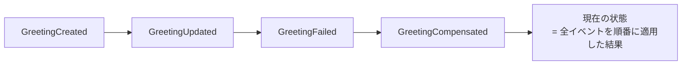

成瀬さんのDDD入門でも説明されているように、**ドメインで起きた事実を忠実に記録する**という考え方はドメイン駆動設計と非常に相性が良いです。

#### 実際の実装例

```go:services/internal/platform/eventstore.go
func (s *EventStore) AppendToStream(ctx context.Context, tx pgx.Tx, streamID, streamType string,
    expectedVersion int, events []UnsavedEvent) (int, error) {
    // Advisory Lockで同一ストリームへの同時書き込みを防ぐ
    if _, err := tx.Exec(ctx, `SELECT pg_advisory_xact_lock(hashtext($1))`, streamID); err != nil {
        return 0, fmt.Errorf("event store: advisory lock: %w", err)
    }

    // 楽観的ロック: 期待するバージョンと実際のバージョンを比較
    var currentVersion int
    err := tx.QueryRow(ctx,
        `SELECT COALESCE(MAX(version), 0) FROM event_store WHERE stream_id = $1`,
        streamID,
    ).Scan(&currentVersion)
    if currentVersion != expectedVersion {
        return 0, ErrConcurrencyConflict  // 競合検出
    }
    // イベントを追記...
}
```

```go:services/internal/greeter/aggregate.go
type GreetingAggregate struct {
    platform.AggregateBase
    Name           string
    Message        string
    ExternalStatus int32
    Status         string // "created", "failed", "compensated"
}

// コマンド: イベントを発生させる
func (a *GreetingAggregate) Create(name, message string, externalStatus int32) {
    a.Raise(EventGreetingCreated, GreetingCreatedData{
        Name:           name,
        Message:        message,
        ExternalStatus: externalStatus,
    })
    a.Name = name
    a.Message = message
    a.ExternalStatus = externalStatus
    a.Status = "created"
}

// イベントの適用: 状態を復元する際に使用
func (a *GreetingAggregate) ApplyEvent(eventType string, data json.RawMessage) {
    switch eventType {
    case EventGreetingCreated:
        var d GreetingCreatedData
        if err := json.Unmarshal(data, &d); err != nil {
            slog.Warn("failed to unmarshal", "error", err)
        }
        a.Name = d.Name
        a.Message = d.Message
        a.ExternalStatus = d.ExternalStatus
        a.Status = "created"
    }
}
```

イベントストアには `stream_id`（集約のID）、`version`（楽観的ロック用）、`event_type`、`data`（JSONペイロード）、`global_position`（全体での順序）が保存されます。

---

### CQRS（Command Query Responsibility Segregation）

#### なぜこれが必要なのか

この repo では Event Sourcing を採用しているため、**データの読み取りをそのまま event store に向けるのは不便**になります。「最新の挨拶一覧を取得したい」という単純なクエリでも、全イベントを再生して状態を構築する必要があるからです。

これはBertrand Meyerが提唱した **CQS（Command Query Separation）** の原則をアーキテクチャレベルに拡張したもので、Greg Youngが2006年頃に **CQRS** として定式化しました。

**CQRS** は「書き込み（Command）」と「読み取り（Query）」のモデルを**分離**します。

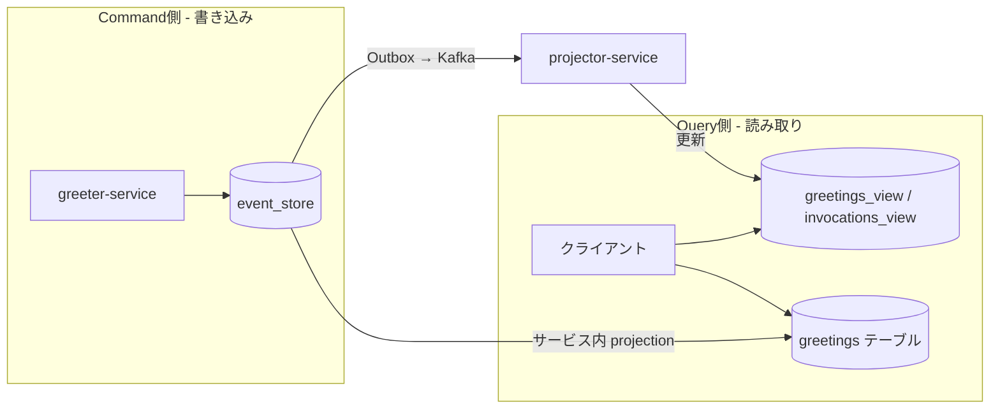

- **書き込み側**: イベントストアにイベントを追記
- **読み取り側**: イベントを元に非正規化されたRead Model（ビューテーブル）を構築し、高速に検索可能

この repo では、`SaveAggregate` による書き込み経路と、projection が更新する read model を分けるために CQRS 的な構成を採っています。read 側の実装場所は 1 つではなく、サービス内 projection と `projector-service` の両方があります。

:::message
既存コードを読むときに混乱しやすい点ですが、この repo には **サービス内で event store をポーリングして read model を更新する projection** と、**Kafka を購読する `projector-service`** の両方が登場します。どちらも「read model を作る側」ですが、配置が違います。
:::

:::message
**注意**: CQRSでは書き込みと読み取りの間に**結果整合性（Eventual Consistency）** が発生します。イベントが発行されてからRead Modelに反映されるまでにわずかな遅延があります。
:::

#### 実際の実装例

**書き込み側（Command）**

```go:services/internal/greeter/service.go
agg := NewGreetingAggregate(uuid.NewString())
agg.Create(name, msg, statusCode)
// イベントストアに保存 + Outboxにイベント挿入（同一トランザクション）
if saveErr := platform.SaveAggregate(ctx, s.eventStore, s.outbox, agg, GreetingTopicMapper); saveErr != nil {
    slog.Error("failed to save greeting aggregate", "error", saveErr)
}
```

**読み取り側（Query） - Projection**

```go:services/internal/greeter/projection.go
type GreetingProjection struct {
    eventStore *platform.EventStore
    pool       *pgxpool.Pool
    position   int64
}

// ポーリングでイベントストアから新しいイベントを取得し、Read Modelを更新
func (p *GreetingProjection) poll(ctx context.Context) error {
    events, err := p.eventStore.LoadAllEvents(ctx, p.position, 100)
    if err != nil {
        return err
    }
    for _, e := range events {
        if err := p.apply(ctx, e); err != nil {
            slog.Error("projection apply error", "event_type", e.EventType, "error", err)
        }
        p.position = e.GlobalPosition
    }
    return nil
}

func (p *GreetingProjection) apply(ctx context.Context, e platform.StoredEvent) error {
    switch e.EventType {
    case EventGreetingCreated:
        // Read Model（greetingsテーブル）にUPSERT
        _, err := p.pool.Exec(ctx,
            `INSERT INTO greetings (id, name, message, external_status, status, created_at)
             VALUES ($1, $2, $3, $4, $5, $6)
             ON CONFLICT (id) DO UPDATE SET name = EXCLUDED.name, ...`,
            e.StreamID, d.Name, d.Message, d.ExternalStatus, "created", e.CreatedAt,
        )
        return err
    }
    return nil
}
```

クライアントは `greetings` テーブルに対して通常のSQLクエリで高速に検索できます。

---

### Outbox パターン（トランザクショナルアウトボックス）

#### なぜこれが必要なのか

Event SourcingとCQRSを実装すると、「DBにイベントを書き込む」と「Kafkaにイベントを発行する」という2つの操作が必要になります。これが**デュアルライト問題**です。

:::message alert
**危険なパターン**: DBにイベントを書き込んだ後、Kafkaにイベントを発行する。DBへの書き込みが成功してもKafkaへの発行が失敗すると、DBには記録されたがKafkaに届かない = **データ不整合**が発生します。
:::

**Outboxパターン**は、イベントの発行もDBへの書き込みとして**同一トランザクション**で行うことでこの問題を解決します。

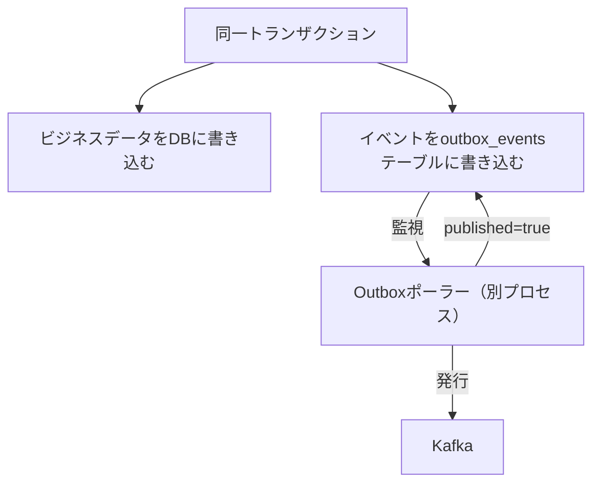

:::message
Outboxパターンが保証するのは**少なくとも1回の配信（at-least-once delivery）** です。重複配信の可能性があるため、消費側は**冪等（Idempotent）** である必要があります。
:::

#### 実際の実装例

**ビジネスロジック + Outbox書き込み（同一トランザクション）**

```go:services/internal/caller/service.go
tx, txErr := s.outbox.BeginTx(ctx)
if txErr != nil {
    slog.Error("failed to begin transaction", "error", txErr)
    return nil, connect.NewError(connect.CodeInternal, txErr)
}

_, execErr := tx.Exec(ctx,
    "INSERT INTO call_logs (url, status_code, body_length) VALUES ($1, $2, $3)",
    targetURL, statusCode, bodyLength,
)
if execErr != nil {
    _ = tx.Rollback(ctx)
    return nil, connect.NewError(connect.CodeInternal, execErr)
}

event := platform.NewEvent("call.completed", "caller-service", map[string]any{
    "url":         targetURL,
    "status_code": statusCode,
    "body_length": bodyLength,
})
if outboxErr := s.outbox.InsertEvent(ctx, tx, platform.TopicCallCompleted, event); outboxErr != nil {
    _ = tx.Rollback(ctx)
    return nil, connect.NewError(connect.CodeInternal, outboxErr)
}
if commitErr := tx.Commit(ctx); commitErr != nil {
    return nil, connect.NewError(connect.CodeInternal, commitErr)
}
```

:::details Outboxポーラーの実装（バックグラウンドでKafkaに発行）
```go:services/internal/platform/outbox.go
func (s *OutboxStore) PublishPending(ctx context.Context) (int, error) {
    tx, _ := s.pool.Begin(ctx)
    defer func() { _ = tx.Rollback(ctx) }()

    // FOR UPDATE SKIP LOCKEDで重複処理を防止
    rows, _ := tx.Query(ctx,
        `SELECT id, event_type, topic, payload
         FROM outbox_events
         WHERE published = FALSE
         ORDER BY created_at ASC
         LIMIT 50
         FOR UPDATE SKIP LOCKED`,
    )

    for _, r := range pending {
        // Kafkaに発行
        s.publisher.PublishRaw(ctx, r.topic, r.id, r.payload)
        // 発行済みマーク
        tx.Exec(ctx,
            `UPDATE outbox_events SET published = TRUE, published_at = $1 WHERE id = $2`,
            time.Now().UTC(), r.id,
        )
    }
    return tx.Commit(ctx)
}
```

ポーラーは指数バックオフ付きで定期的に実行され、未発行のイベントをKafkaに送信します。`FOR UPDATE SKIP LOCKED` により、複数のポーラーインスタンスが同じイベントを処理することを防ぎます。
:::

Node.js側にも同様のOutbox実装があり、auth-serviceやcustom-lang-serviceで使用されています。

---

### Saga パターン

#### なぜこれが必要なのか

モノリスでは、複数のテーブルにまたがる操作を**1つのデータベーストランザクション**でアトミックに実行できます。

```sql
-- モノリスなら簡単
BEGIN;
INSERT INTO orders (...);
UPDATE inventory SET stock = stock - 1;
INSERT INTO payments (...);
COMMIT;  -- 全部成功 or 全部ロールバック
```

しかしマイクロサービスでは、各サービスが独自のデータベースを持つため、**分散トランザクション**が必要になります。従来の2フェーズコミット（2PC）はパフォーマンスが悪く、単一障害点になりやすいため、マイクロサービスには不向きです。

**Sagaパターン**は、1987年にHector Garcia-MolinaとKenneth Salemが提案したパターンで、長時間トランザクションを**一連のローカルトランザクション**に分割します。各ステップが失敗した場合は、**補償トランザクション（Compensating Transaction）** を実行して、それまでの変更を取り消します。

Sagaには2つの調整方式があります。
- **コレオグラフィ**: 各サービスがイベントに反応して次のステップを実行（分散的）
- **オーケストレーション**: 中央のオーケストレーターが各サービスに指示を出す（集中的）

このプロジェクトでは**コレオグラフィ方式**をベースにした軽量な補償処理を採用しています。

#### 実際の実装例

**例: greeter-service が失敗イベントを発行し、補償ハンドラが後続処理を行う**

```go:services/internal/greeter/service.go
func (s *Service) Greet(ctx context.Context, req *connect.Request[greeterv1.GreetRequest])
    (*connect.Response[greeterv1.GreetResponse], error) {

    // Step 1: caller-serviceを呼び出し（Circuit Breaker + Retry + Bulkhead付き）
    err := s.callerBulkhead.Execute(rpcCtx, func() error {
        return platform.RetryWithBackoff(rpcCtx, func() error {
            result, cbErr := platform.CBExecute(s.callerCB, func() (*callerv1.CallExternalResponse, error) {
                return s.callerClient.CallExternal(rpcCtx, connect.NewRequest(&callerv1.CallExternalRequest{Url: s.externalURL}))
            })
            callerResult = result
            return cbErr
        }, platform.WithMaxRetries(3))
    })

    if err != nil {
        // 失敗時: greeting.failed イベントを発行 → 補償トランザクションのトリガー
        s.publishFailedEvent(ctx, name, err)
        return nil, err
    }

    // Step 2: 成功時: イベントストアに保存 + greeting.created イベントを発行
    agg := NewGreetingAggregate(uuid.NewString())
    agg.Create(name, msg, callerResult.GetStatusCode())
    platform.SaveAggregate(ctx, s.eventStore, s.outbox, agg, GreetingTopicMapper)
    return resp, nil
}
```

:::message
ここで示しているのは「注文・決済・在庫」のような教科書的 Saga をそのまま再現した例ではなく、**この repo の軽量な失敗イベント + 補償ハンドラ** の説明です。概念を掴むための例として読んでください。
:::

:::details 補償ハンドラの実装
```go:services/cmd/greeter/main.go
compensation := platform.NewCompensationRouter()
compensation.Handle(platform.TopicGreetingFailed, func(ctx context.Context, event platform.Event) error {
    data, _ := event.Data.(map[string]any)
    streamID, _ := data["stream_id"].(string)

    // 集約をロードして補償イベントを適用
    agg := greeter.NewGreetingAggregate(streamID)
    platform.LoadAggregate(ctx, eventStore, agg)
    agg.Compensate("saga compensation")  // 状態を "compensated" に変更
    platform.SaveAggregate(ctx, eventStore, outbox, agg, greeter.GreetingTopicMapper)
    slog.Info("compensation: greeting compensated via ES", "stream_id", streamID)
    return nil
})
```
:::

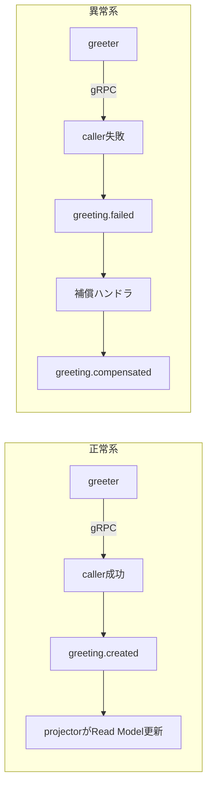

---

### Circuit Breaker（サーキットブレーカー）

#### なぜこれが必要なのか

マイクロサービスでは、あるサービスがダウンしたとき、それを呼び出している側のサービスまで連鎖的に障害が伝播する**カスケード障害**が発生します。

モノリスでは単一プロセス内の関数呼び出しなのでネットワーク障害は起きませんが、マイクロサービスでは「呼び出し先が応答しない」という状況が日常的に発生します。タイムアウトまで待ち続けるとスレッドやコネクションが枯渇し、システム全体がダウンします。

**Circuit Breaker** は、Michael Nygardが著書『Release It!』で紹介したパターンで、電気のブレーカーと同じ発想です。障害を検知したら回路を「開く」ことで、障害の伝播を防ぎます。

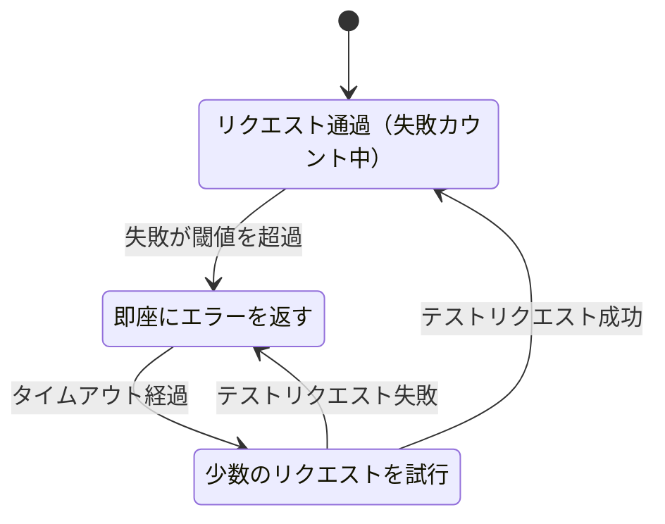

#### 実際の実装例

```go:services/internal/platform/circuitbreaker.go
func DefaultCBConfig(name string) CircuitBreakerConfig {
    return CircuitBreakerConfig{
        Name:          name,
        MaxRequests:   3,           // Half-Open時の最大試行回数
        Interval:      10 * time.Second, // 失敗カウントのリセット間隔
        Timeout:       30 * time.Second, // Open→Half-Openまでの待ち時間
        TripThreshold: 5,           // 連続失敗この回数でOpenに遷移
    }
}

func NewCircuitBreaker[T any](cfg CircuitBreakerConfig) *gobreaker.CircuitBreaker[T] {
    return gobreaker.NewCircuitBreaker[T](gobreaker.Settings{
        Name:        cfg.Name,
        MaxRequests: cfg.MaxRequests,
        Interval:    cfg.Interval,
        Timeout:     cfg.Timeout,
        ReadyToTrip: func(counts gobreaker.Counts) bool {
            return counts.ConsecutiveFailures >= cfg.TripThreshold
        },
        OnStateChange: func(name string, from, to gobreaker.State) {
            slog.Warn("circuit breaker state change",
                "name", name, "from", from.String(), "to", to.String(),
            )
        },
    })
}
```

---

### Bulkhead（バルクヘッド）

#### なぜこれが必要なのか

Circuit Breakerだけでは不十分な場合があります。呼び出し先が遅延している（ダウンはしていない）場合、大量のリクエストがタイムアウト待ちでスレッドを占有し、他の正常な処理まで巻き添えになります。

**Bulkhead** は船の隔壁（バルクヘッド）に由来するパターンで、**同時実行数を制限**することでリソースの枯渇を防ぎます。船が浸水しても隔壁で区切られていれば全体は沈みません。

#### 実際の実装例

```go:services/internal/platform/bulkhead.go
type Bulkhead struct {
    sem     *semaphore.Weighted
    maxSize int64
}

func NewBulkhead(maxConcurrent int64) *Bulkhead {
    return &Bulkhead{
        sem:     semaphore.NewWeighted(maxConcurrent),
        maxSize: maxConcurrent,
    }
}

func (b *Bulkhead) Execute(ctx context.Context, fn func() error) error {
    if err := b.sem.Acquire(ctx, 1); err != nil {
        return fmt.Errorf("bulkhead acquire: %w", err)
    }
    defer b.sem.Release(1)
    return fn()
}
```

**使用例: caller-serviceへの同時呼び出しを最大10に制限**

```go:services/internal/greeter/service.go
s.callerBulkhead = platform.NewBulkhead(10)

err := s.callerBulkhead.Execute(rpcCtx, func() error {
    return platform.RetryWithBackoff(rpcCtx, func() error {
        result, cbErr := platform.CBExecute(s.callerCB, func() (*callerv1.CallExternalResponse, error) {
            return s.callerClient.CallExternal(rpcCtx, ...)
        })
        // ...
    }, platform.WithMaxRetries(3))
})
```

:::message
この例では、**Bulkhead → Retry → Circuit Breaker** の順に3つの耐障害パターンが組み合わされています。外側から順に「同時実行数制限 → リトライ → 障害検知」というレイヤー構造です。
:::

---

### Retry with Exponential Backoff（指数バックオフ付きリトライ）

#### なぜこれが必要なのか

一時的なネットワーク障害やサービスの過負荷は、少し待てば回復することが多いです。しかし即座にリトライすると、障害中のサービスにさらに負荷をかけてしまいます。

**指数バックオフ**は、リトライ間隔を指数関数的に増やすことで、復旧の余地を与えます。さらに**ジッター（ランダム化）** を加えることで、多数のクライアントが同時にリトライする「サンダリングハード（thundering herd）」問題を緩和します。

#### 実際の実装例

```go:services/internal/platform/retry.go
func RetryWithBackoff(ctx context.Context, op func() error, opts ...RetryOption) error {
    cfg := &RetryConfig{
        MaxRetries:   3,
        InitialDelay: 100 * time.Millisecond,
        MaxDelay:     5 * time.Second,
    }

    b := backoff.NewExponentialBackOff()
    b.InitialInterval = cfg.InitialDelay
    b.MaxInterval = cfg.MaxDelay
    b.RandomizationFactor = 0.5 // ジッター: ±50%のランダム化

    _, err := backoff.Retry(ctx, func() (struct{}, error) {
        return struct{}{}, op()
    },
        backoff.WithBackOff(b),
        backoff.WithMaxTries(cfg.MaxRetries),
    )
    return err
}
```

---

### Idempotency（冪等性）

#### なぜこれが必要なのか

Outboxパターンが**at-least-once delivery（少なくとも1回の配信）** を保証するということは、**同じメッセージが複数回届く可能性がある**ということです。また、ネットワークの不安定さからクライアントが同じリクエストを再送することもあります。

**冪等性**とは、同じ操作を何回実行しても結果が変わらない性質です。これを保証することで、重複リクエストによるデータの二重登録などを防ぎます。

#### 実際の実装例

```go:services/internal/platform/idempotency.go
// connect-goのInterceptor（ミドルウェア）として実装
func NewIdempotencyInterceptor(store *IdempotencyStore) connect.Interceptor {
    return connect.UnaryInterceptorFunc(func(next connect.UnaryFunc) connect.UnaryFunc {
        return func(ctx context.Context, req connect.AnyRequest) (connect.AnyResponse, error) {
            key := req.Header().Get("Idempotency-Key")
            if key == "" {
                return next(ctx, req) // キーがなければ通常処理
            }

            // キャッシュされたレスポンスがあればそれを返す
            if cachedResp := tryResolveCached(ctx, store, key, procedure); cachedResp != nil {
                return cachedResp, nil
            }

            // 初回: 通常処理を実行
            resp, err := next(ctx, req)
            if err != nil {
                return resp, err
            }

            // レスポンスをDBに保存（24時間有効）
            storeIdempotencyResponse(ctx, store, key, resp)
            return resp, nil
        }
    })
}
```

クライアントは `Idempotency-Key` ヘッダーを付けてリクエストを送ります。同じキーで再度リクエストが来た場合、処理を実行せずにキャッシュされたレスポンスを返します。

---

### Snapshot（スナップショット）

#### なぜこれが必要なのか

Event Sourcingでは、集約の現在の状態を得るために**全イベントを先頭から再生**する必要があります。イベントが数千件、数万件に膨れ上がると、再生にかかる時間が無視できなくなります。

**スナップショット**は、ある時点の集約の状態をキャプチャして保存することで、全イベントの再生を省略できるようにします。スナップショット以降のイベントだけを再生すれば現在の状態が得られます。

:::message
Snapshot / Upcaster は platform に入っている拡張機能です。現時点の標準開発フローで毎回使うわけではありませんが、イベント数増加やスキーマ進化に備えた仕組みとして知っておくと役立ちます。
:::

#### 実際の実装例

```go:services/internal/platform/snapshot.go
// スナップショット + 残りのイベントから集約をロード
func LoadAggregateWithSnapshot(ctx context.Context, store *EventStore, snapshots *SnapshotStore,
    upcasters *UpcasterRegistry, agg Aggregate) error {

    fromVersion := 0

    // スナップショットがあればそこから復元
    if snappable, ok := agg.(Snapshotable); ok && snapshots != nil {
        snap, _ := snapshots.Load(ctx, agg.AggregateID())
        if snap != nil {
            snappable.UnmarshalSnapshot(snap.State)
            agg.SetVersion(snap.Version)
            fromVersion = snap.Version  // この時点以降のイベントだけ再生
        }
    }

    // スナップショット以降のイベントを再生
    events, _ := store.LoadStreamFrom(ctx, agg.AggregateID(), fromVersion)
    for _, e := range events {
        data := e.Data
        if upcasters != nil {
            data = upcasters.Apply(e.EventType, data) // イベントのバージョンアップ
        }
        agg.ApplyEvent(e.EventType, data)
    }
    return nil
}
```

**Upcaster** は、イベントのスキーマが変更された場合に古いイベントを新しいフォーマットに変換する仕組みです。Event Sourcingではイベントは不変（immutable）なので、スキーマ変更時は再生時に変換します。

---

# infra側

ここからは `microservices-infra` 側の説明です。app 側の開発だけなら、最初は全部を理解する必要はありません。Kind + Tilt を使った開発、トラブルシュート、観測基盤の読み解きが必要になったときに読むパートです。

マイクロサービスでは、複数のサービスが独立して動作するため、**オブザーバビリティ（可観測性）** とインフラストラクチャの管理が格段に重要になります。

## アーキテクチャ

infra側は **Kind（Kubernetes in Docker）** をベースにしたローカル開発用の Kubernetes プラットフォームです。主に次の 3 モードを使います。

| モード | 実行コマンド | CNI | Service Mesh | GitOps | 起動時間 | 用途 |
|--------|-------------|-----|-------------|--------|---------|------|
| dev-fast | `bootstrap` | kindnetd | なし | なし | ~120秒 | 日常開発 |
| Cilium | `bootstrap-full` / `bootstrap --full` | Cilium + Hubble | なし | なし | ~200秒 | CNI テスト、ネットワーク可視化 |
| full | `full-bootstrap` | Cilium + Hubble | Istio Ambient | ArgoCD | ~250秒 | フルスタック検証 |

`bootstrap` と `full-bootstrap` は warm cluster 対応で、2回目以降は差分だけ再適用されることがあります。フルリビルドが必要なときは `--clean` を付けます。

オブザーバビリティスタックは **Loki / Grafana / Tempo / Prometheus** を中心に構成されています。

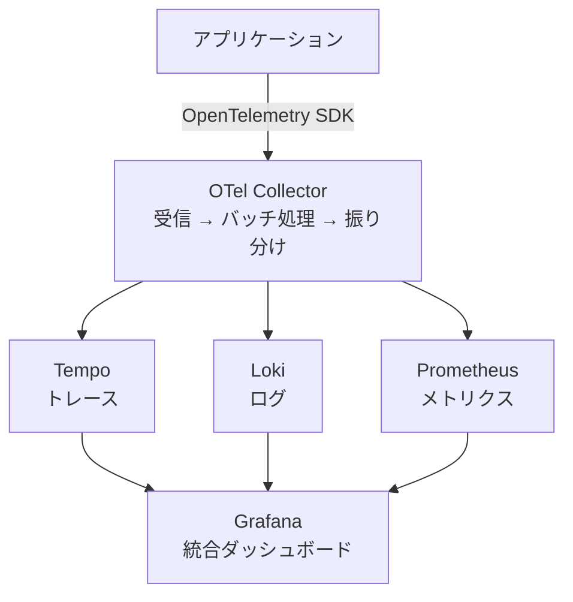

インフラの構成管理には **nixidy**（NixベースのKubernetesマニフェスト生成ツール）を使用し、数百個規模の Kubernetes マニフェストを複数のコンポーネントから生成しています。

## 用語解説

### OpenTelemetry（OTel）

#### なぜこれが必要なのか

モノリスでは、ログを `grep` すれば大抵の問題は追跡できます。しかしマイクロサービスでは、1つのリクエストが複数のサービスをまたいで処理されるため、どのサービスで何が起きたかを**横断的に追跡**する必要があります。

以前は、メトリクス（Prometheus）、ログ（Fluentd）、トレース（Jaeger）がそれぞれ独自のSDKとフォーマットを持っていて、計装（instrumentation）が複雑でした。

**OpenTelemetry**（CNCF）は、メトリクス・ログ・トレースの3つのシグナルを**統一されたAPIとSDK**で扱えるベンダー中立の観測フレームワークです。OpenTracingとOpenCensusの統合から生まれました。

**OpenTelemetry Collector** は、テレメトリデータを受信（Receiver）→ 処理（Processor）→ 送信（Exporter）するパイプラインです。アプリケーションはCollectorにデータを送るだけで、バックエンドの切り替えはCollectorの設定変更だけで完結します。

#### 実際の実装例

```yaml:nixidy/env/local/otel-collector.nix
receivers:
  otlp:
    protocols:
      grpc:
        endpoint: 0.0.0.0:4317  # gRPCで受信
      http:
        endpoint: 0.0.0.0:4318  # HTTPで受信

processors:
  batch: {}  # バッチ処理でスループット向上

exporters:
  # トレース → Tempo
  otlp:
    endpoint: tempo.observability:4317
    tls:
      insecure: true
  # メトリクス → Prometheus
  prometheusremotewrite:
    endpoint: http://kube-prometheus-stack-prometheus.observability:9090/api/v1/write
  # ログ → Loki
  otlphttp:
    endpoint: http://loki.observability:3100/otlp

service:
  pipelines:
    traces:
      receivers: [otlp]
      processors: [batch]
      exporters: [otlp]         # → Tempo
    metrics:
      receivers: [otlp]
      processors: [batch]
      exporters: [prometheusremotewrite]  # → Prometheus
    logs:
      receivers: [otlp]
      processors: [batch]
      exporters: [otlphttp]     # → Loki
```

---

### Prometheus（メトリクス監視）

#### なぜこれが必要なのか

マイクロサービスでは「どのサービスが遅いのか」「どのサービスのエラーレートが高いのか」をリアルタイムに把握する必要があります。

**Prometheus** はCNCFのメトリクス監視ツールで、**プルベース**のアーキテクチャが特徴です。Prometheusが各サービスの `/metrics` エンドポイントを定期的にスクレイプ（取得）します。

プルベースの利点:
- **監視対象の健全性が自動で分かる**: スクレイプに失敗 = サービスがダウン（`up` メトリクス）
- **中央管理**: 何を監視するか Prometheus 側で制御できる
- **テストが簡単**: ローカルで `/metrics` にアクセスすれば確認できる

対して、Collector や Agent 経由で送る**プッシュ寄りの収集方式**では、送信が止まった理由が「サービス停止」なのか「経路の問題」なのかを切り分ける設計が別途必要になります。

#### 実際の実装例

```yaml:nixidy/env/local/kube-prometheus-stack.nix
prometheusSpec:
  replicas: 1
  retention: 24h                     # 24時間保持
  enableRemoteWriteReceiver: true    # OTel Collectorからのリモートライト受信
  storageSpec:
    volumeClaimTemplate:
      spec:
        resources:
          requests:
            storage: 5Gi
  # ServiceMonitor / PodMonitorの自動検出を有効化
  serviceMonitorSelectorNilUsesHelmValues: false
  podMonitorSelectorNilUsesHelmValues: false
```

NodePortで `30090` ポートに公開され、ブラウザから直接PromQLクエリを実行できます。

---

### Loki（ログ集約）

#### なぜこれが必要なのか

マイクロサービスでは各サービスが個別にログを出力するため、「あるリクエストに関連するログを全サービスから横断的に収集する」ことが必要になります。

従来の **ELKスタック（Elasticsearch + Logstash + Kibana）** はログの全文検索に優れますが、Elasticsearchの全文インデックスは**ストレージとCPUを大量に消費**します。

**Grafana Loki** は「ログの本文にはインデックスを作らない」という割り切った設計で、**ラベル（メタデータ）のみをインデックス化**します。ログ本文はS3互換のオブジェクトストレージに安価に保存され、クエリ時にスキャンされます。

| 比較項目 | Loki | Elasticsearch (ELK) |
|---------|------|---------------------|
| インデックス対象 | ラベルのみ | 全文 |
| ストレージコスト | 低い（オブジェクトストレージ） | 高い（インデックス用ストレージ） |
| 検索能力 | ラベルで絞り込んでからスキャン | 自由な全文検索 |
| リソース使用量 | 少ない | 多い |
| Kubernetes親和性 | 高い（ラベルベース） | 中程度 |

#### 実際の実装例

```yaml:nixidy/env/local/loki.nix
deploymentMode: SingleBinary
auth_enabled: false

storage:
  type: s3
  s3:
    endpoint: http://garage.storage:3900   # Garage（S3互換）をバックエンド
    region: garage
    s3forcepathstyle: true
  bucketNames:
    chunks: loki-chunks

schemaConfig:
  configs:
    - from: 2024-01-01
      store: tsdb
      object_store: s3
      schema: v13
      index:
        prefix: loki_index_
        period: 24h
```

バックエンドのオブジェクトストレージには **Garage**（Rust製のS3互換分散ストレージ）を使用しています。

---

### Tempo（分散トレーシング）

#### なぜこれが必要なのか

マイクロサービスでは、1つのユーザーリクエストが `frontend → traefik → greeter-service → caller-service → 外部API` と複数のサービスを経由します。「このリクエストはどこで遅延したのか？」を調べるには、**分散トレーシング**が必要です。

各サービスが処理開始時に「スパン（Span）」を生成し、それらを **Trace ID** で紐づけることで、リクエストの全経路を可視化します。

**Grafana Tempo** は Loki と同様の設計思想で、オブジェクトストレージを前提にした軽量なトレーシングバックエンドです。この repo では Grafana からトレースを辿る用途を主眼に使っています。

| 比較項目 | Tempo | Jaeger |
|---------|-------|--------|
| 保存戦略 | オブジェクトストレージ中心 | Elasticsearch / Cassandra など |
| UI | Grafana（共通UI） | 専用UI |
| 検索体験 | Grafana/TraceQL 経由で探索 | 属性ベースの検索に強い |
| 運用の重さ | 比較的軽量 | 構成次第で重くなりやすい |
| エコシステム | Grafanaスタック統合 | 独立した大きなコミュニティ |

#### 実際の実装例

```yaml:nixidy/env/local/tempo.nix
tempo:
  storage:
    trace:
      backend: s3
      s3:
        endpoint: garage.storage:3900
        bucket: tempo-traces
        region: garage
  receivers:
    otlp:
      protocols:
        grpc:
          endpoint: 0.0.0.0:4317
        http:
          endpoint: 0.0.0.0:4318
  metricsGenerator:
    enabled: true   # トレースからメトリクスを自動生成
    remoteWriteUrl: http://kube-prometheus-stack-prometheus.observability:9090/api/v1/write
```

`metricsGenerator` により、トレースデータからRED メトリクス（Rate, Errors, Duration）が自動生成され、Prometheusに送信されます。

---

### Grafana（統合ダッシュボード）

#### なぜこれが必要なのか

Prometheus、Loki、Tempo がそれぞれメトリクス・ログ・トレースを収集しても、別々のUIで確認するのは非効率です。

**Grafana** はこれらのデータソースを**統合的に可視化**するダッシュボードツールです。最大の利点は**シグナル間の相関分析**です。

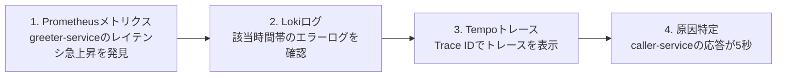

このプロジェクトでは **Grafonnet**（Jsonnet）でダッシュボードをコードとして管理し、Git管理しています。

#### 実際の実装例

| 項目 | 値 |
|------|-----|
| URL | http://localhost:30300 |
| User | admin |
| Pass | admin |

データソース（自動設定済み）:
- **Prometheus**: メトリクスクエリ (PromQL)
- **Loki**: ログクエリ (LogQL)
- **Tempo**: トレース可視化（TracesToLogs: トレースからログへの相関リンク付き）

---

### Traefik（Ingress Controller / APIゲートウェイ）

#### なぜこれが必要なのか

Kubernetes上に複数のサービスがデプロイされていても、外部からアクセスするにはエントリーポイントが必要です。

モノリスでは1つのサーバーにNginxを置けば済みますが、マイクロサービスでは「パスに応じて適切なサービスにルーティング」「認証」「レート制限」「CORS」などの横断的な関心事をサービスの外側で処理する必要があります。

**Traefik** は Kubernetes ネイティブなリバースプロキシで、Kubernetes APIを監視してサービスの追加・削除を**自動検出**します。設定変更にリスタートが不要です。

| 比較項目 | Traefik | Nginx |
|---------|---------|-------|
| サービス検出 | Kubernetes API自動監視 | 手動設定（reload必要） |
| 設定更新 | 動的（リスタート不要） | 設定変更後 reload 必要 |
| gRPCサポート | ネイティブ（h2c） | 設定で対応可能 |
| ミドルウェア | 宣言的に追加 | location/server ブロック内 |

#### 実際の実装例

```nix:deploy/nixidy/env/traefik.nix
# gRPCサービス → h2cプロトコルでルーティング
{
  applications.traefik = {
    namespace = "edge";
    helm.releases.traefik = {
      values.extraObjects = [
        {
          apiVersion = "traefik.io/v1alpha1";
          kind = "IngressRoute";
          metadata = {
            name = "greeter-route";
            namespace = "microservices";
          };
          spec.routes = [
            {
              match = "PathPrefix(`/greeter.v1.GreeterService`)";
              services = [
                {
                  name = "greeter-service";
                  port = 80;
                  scheme = "h2c";
                }
              ];
            }
          ];
        }
      ];
    };
  };
}
```

OTelトレーシングも統合されており、Traefikを通過するリクエストが自動的にトレースされます。

---

### Cilium & Hubble（eBPFベースネットワーキング）

#### なぜこれが必要なのか

Kind の軽量構成や、一般的な iptables ベースの CNI では、ルール数が増えるとパフォーマンスや運用性が課題になりやすく、また「どのPodがどのPodにgRPCリクエストを送っているか」といったL7レベルの情報は見えにくいです。

**Cilium** は eBPF（extended Berkeley Packet Filter）を使ってLinuxカーネルレベルでネットワーキングを行うCNI（Container Network Interface）です。IPTablesを使わずにパケットを処理するため、大規模クラスターでも高性能です。

**Hubble** は Cilium 上に構築された可観測性レイヤーで、以下を提供します。
- ネットワークフローのリアルタイム可視化
- L7プロトコル（HTTP、gRPC、DNS、Kafka）の認識
- サービス依存関係マップ

#### 実際の実装例

```bash
# Ciliumモードでクラスター起動
bootstrap-full

# Hubble UIへアクセス
# http://localhost:31235

# Hubble CLIでリアルタイムフロー監視
hubble observe --namespace microservices
```

---

### Istio Ambient Mode（サービスメッシュ）

#### なぜこれが必要なのか

マイクロサービスが増えると、サービス間の**mTLS（相互TLS）**、**認可**、**リトライポリシー**、**トラフィック管理**を各サービスに個別実装するのは現実的ではありません。

**サービスメッシュ**はこれらの横断的関心事をアプリケーションコードから切り離し、インフラレイヤーで透過的に処理します。

従来の **Istioサイドカーモード** では、各Podに Envoyプロキシを注入します。しかしこれはリソースオーバーヘッドが大きく、プロキシの更新にはPodの再起動が必要でした。

**Ambient Mode** はサイドカーを廃止し、2層アーキテクチャを採用します。
- **ztunnel**: ノードごとのL4プロキシ（Rust製DaemonSet）。mTLSとL4認可を処理
- **Waypoint Proxy**: Namespaceごとの任意のL7プロキシ。HTTPルーティング、リトライ、L7認可など

| 比較項目 | サイドカーモード | Ambient Mode |
|---------|---------------|-------------|
| プロキシ配置 | Pod内にEnvoyを注入 | ノードにztunnel + 任意のWaypoint |
| リソースオーバーヘッド | 大（Pod数×Envoy） | 小（ノード数×ztunnel） |
| Pod再起動 | メッシュ追加時に必要 | 不要（ラベル付与のみ） |
| L7機能 | 全Podに適用 | 必要なNamespaceのみ（opt-in） |

#### 実際の実装例

:::details JWT認証ポリシー
```yaml:istio/authorization-policy.yaml
apiVersion: security.istio.io/v1
kind: RequestAuthentication
metadata:
  name: jwt-auth
  namespace: microservices
spec:
  targetRefs:
    - kind: Gateway
      group: gateway.networking.k8s.io
      name: waypoint
  jwtRules:
    - issuer: "auth-service"
      jwksUri: "http://auth-service.microservices.svc.cluster.local:8090/.well-known/jwks.json"
      forwardOriginalToken: true
```
:::

:::details 認可ポリシー（JWT必須 or 公開パス or サービス間通信）
```yaml:istio/authorization-policy.yaml
apiVersion: security.istio.io/v1
kind: AuthorizationPolicy
metadata:
  name: require-jwt-or-public
  namespace: microservices
spec:
  targetRefs:
    - kind: Gateway
      group: gateway.networking.k8s.io
      name: waypoint
  action: ALLOW
  rules:
    - from:
        - source:
            requestPrincipals: ["*"]           # 有効なJWT
    - to:
        - operation:
            paths: ["/auth/*", "/healthz", "/.well-known/*"]      # 公開パス
    - from:
        - source:
            principals: ["cluster.local/ns/microservices/sa/*"]  # サービス間
```
:::

:::details トラフィックポリシー（接続プーリング + 異常検出 + ロードバランシング）
```yaml:istio/destination-rules.yaml
apiVersion: networking.istio.io/v1
kind: DestinationRule
metadata:
  name: greeter-service
spec:
  host: greeter-service
  trafficPolicy:
    connectionPool:
      tcp:
        maxConnections: 100
      http:
        h2UpgradePolicy: UPGRADE
        http2MaxRequests: 50
    outlierDetection:
      consecutive5xxErrors: 5        # 5回連続5xxで排除
      interval: 10s
      baseEjectionTime: 30s
      maxEjectionPercent: 50
    loadBalancer:
      simple: LEAST_REQUEST          # 最小リクエスト数ベース
```
:::

---

### nixidy（Nixベースのマニフェスト管理）

#### なぜこれが必要なのか

Kubernetesのマニフェスト管理には Helm、Kustomize、jsonnet など様々なツールがありますが、それぞれ課題があります。
- **Helm**: テンプレートの型安全性がない。複雑なvaluesの管理が困難
- **Kustomize**: パッチの積み重ねで可読性が低下
- **Plain YAML**: 重複が多く保守性が低い

**nixidy** は NixOS のモジュールシステムを使ってKubernetesリソースを**型安全に**定義し、プレーンなYAMLマニフェストを生成します。生成されたYAMLはGitにコミットされ、ArgoCDが「Rendered Manifests」パターンで同期します。

NixOSモジュールの型システムにより、設定値のタイプミスがビルド時に検出され、環境（dev/staging/prod）ごとの差分を安全にオーバーライドできます。

#### 実際の実装例

```nix:nixidy/env/local/kube-prometheus-stack.nix
{
  applications.kube-prometheus-stack = {
    namespace = "observability";
    helm.releases.kube-prometheus-stack = {
      values = {
        grafana.service = {
          type = "NodePort";
          nodePort = 30300;
        };
        prometheus.service = {
          type = "NodePort";
          nodePort = 30090;
        };
      };
    };
  };
}
```

```bash
# マニフェスト生成
./scripts/gen-manifests.sh

# 生成結果: manifests/ ディレクトリに多数の YAML ファイルが出力される
```

---

### ArgoCD（GitOps）

#### なぜこれが必要なのか

マイクロサービスではデプロイするサービスが多く、「どのバージョンがどの環境にデプロイされているか」を管理するのが困難です。

**ArgoCD** は **GitOps** ツールで、Gitリポジトリの状態をKubernetesクラスターの「あるべき姿」として扱います。Gitにプッシュされたマニフェストの変更が自動的にクラスターに反映されます。

手動での `kubectl apply` が不要になり、デプロイの履歴がGitのコミット履歴と一致します。ロールバックも `git revert` で可能です。

#### 実際の実装例

```yaml:argocd/services-appset.yaml
apiVersion: argoproj.io/v1alpha1
kind: ApplicationSet
metadata:
  name: services
  namespace: argocd
spec:
  generators:
    - git:
        repoURL: https://github.com/hackz-megalo-cup/microservices-app.git
        directories:
          - path: services/*/k8s/generated     # 各サービスのマニフェスト
          - path: frontend/k8s/generated       # フロントエンドのマニフェスト
  template:
    spec:
      source:
        repoURL: https://github.com/hackz-megalo-cup/microservices-app.git
        targetRevision: main
        path: '{{path}}'
      destination:
        server: https://kubernetes.default.svc
      syncPolicy:
        automated:
          prune: true       # Git上で削除されたリソースをクラスターからも削除
          selfHeal: true    # 手動変更を自動で元に戻す
```

記事中では現行の repo 名で示しています。実際の `services-appset.yaml` を読むときは、環境ごとの `repoURL` 差し替えもあわせて確認してください。

---

# まとめ

この記事では、`microservices-app` / `microservices-infra` で開発するときに登場する技術とパターンを、実際のコードベースを題材に解説しました。

**app側のパターン**は、分散システムの複雑さに対処するためのものです。
- **gRPC / connect-go**: 型安全なサービス間通信
- **メッセージキュー（Kafka/Redpanda）**: 非同期通信でサービスを疎結合に
- **Event Sourcing**: 状態変化をイベントとして記録
- **CQRS**: 読み書きモデルの分離で最適化
- **Outboxパターン**: データベース更新とイベント発行のアトミック性を保証
- **Sagaパターン**: 分散トランザクションの代替
- **Circuit Breaker / Bulkhead / Retry**: 耐障害性の確保
- **Idempotency**: 重複リクエストへの対処

**infra側のツール**は、分散システムを運用可能にするためのものです。
- **OpenTelemetry**: 統一的なテレメトリ収集
- **Prometheus / Loki / Tempo / Grafana**: メトリクス・ログ・トレースの統合オブザーバビリティ
- **Traefik**: 動的なAPIゲートウェイ
- **Cilium + Hubble**: eBPFベースの高性能ネットワーキングと可視化
- **Istio Ambient Mode**: サイドカーレスのサービスメッシュ
- **nixidy**: 型安全なマニフェスト管理
- **ArgoCD**: GitOpsによる宣言的デプロイ

大事なのは、これらを最初から全部使いこなすことではありません。まずは `new-service` の標準形に沿って開発し、必要になったときに「なぜこの repo がこうなっているのか」をこの記事に戻って確認できれば十分です。

実際に開発する際は、まず `new-service` コマンドでサービスの雛形を生成し、**proto → events.go → aggregate.go → service.go** の流れで実装を進めます。Event Store、Outbox、Circuit Breaker 等の共通基盤は platform パッケージが担うため、開発者はまずビジネスロジックに集中できます。

既存サービスを読むと scaffold より複雑に見えることがありますが、そのときは「標準形からどこが拡張されているのか」という観点で読むと追いやすくなります。

この記事がその理解の助けになれば幸いです。
